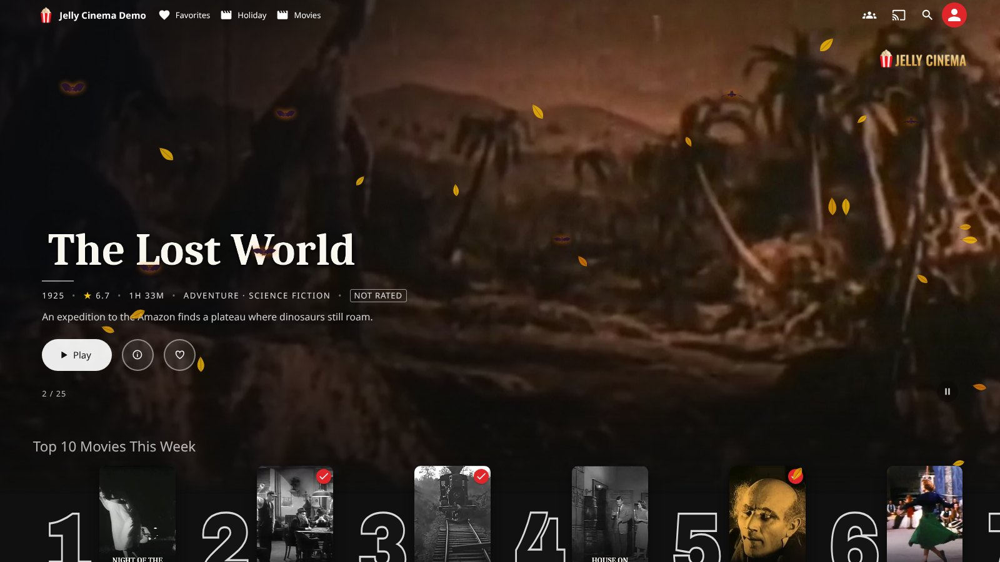
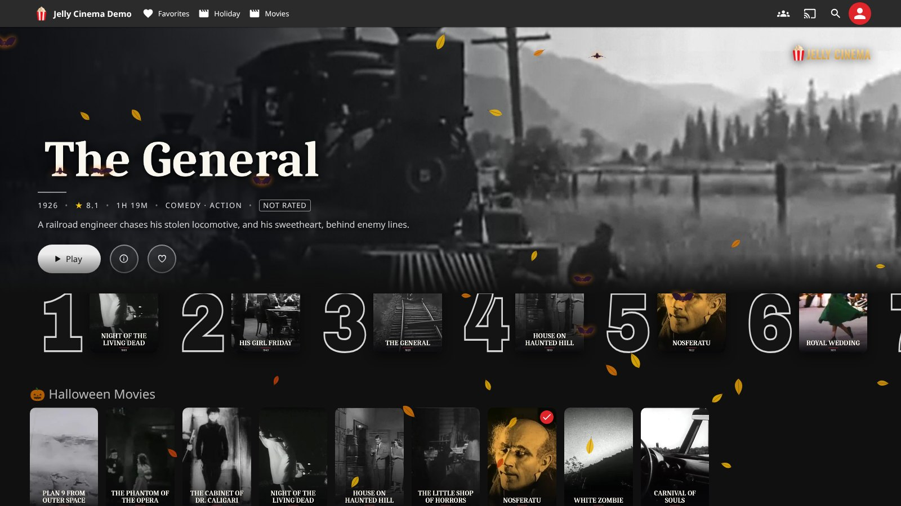
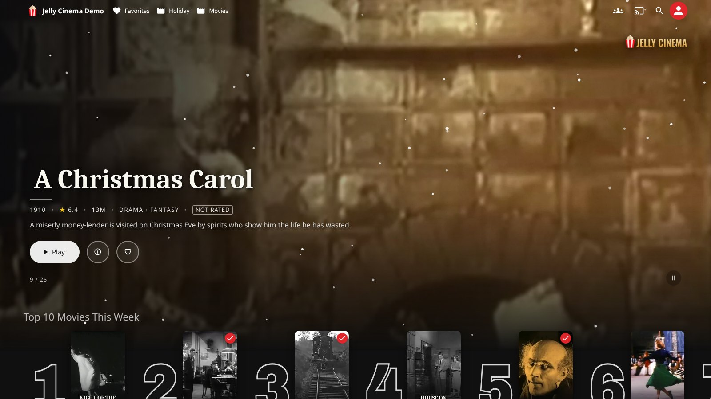
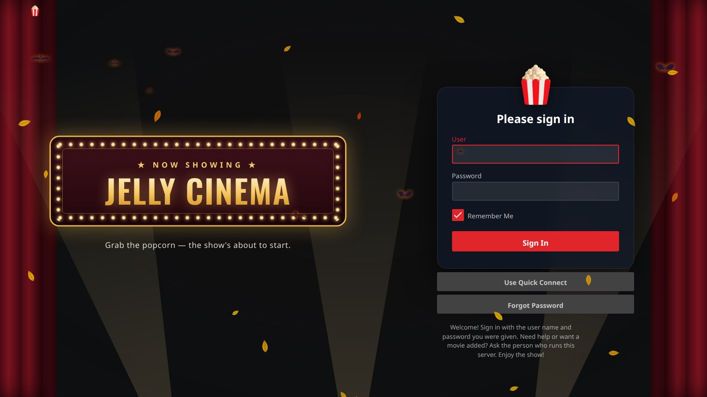
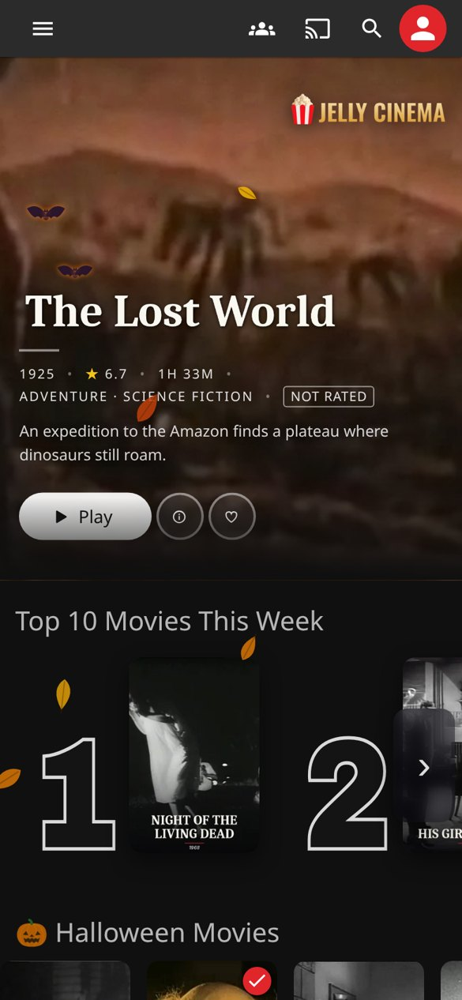
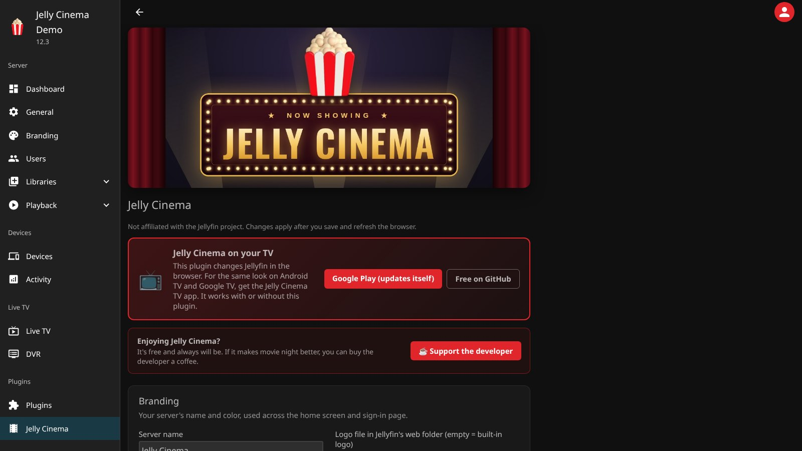

<p align="center">
  
</p>

<h1 align="center">Jelly Cinema</h1>

<p align="center">
  Turn your Jellyfin home screen into a movie theater lobby.<br>
  A cinematic banner with trailers, a Top 10 row, rows that change with the holidays, and seasonal effects.
  Free, open source, and safe for every account on your server.
</p>

<p align="center">
  <a href="#install">Install</a> ·
  <a href="#features">Features</a> ·
  <a href="#settings">Settings</a> ·
  <a href="#on-your-tv">TV app</a> ·
  <a href="#privacy-and-safety">Privacy</a> ·
  <a href="https://ko-fi.com/techsystems23">Support the developer</a>
</p>

> [!TIP]
> **📺 Watching on a TV?** Get the **Jelly Cinema TV app** for Android TV and Google TV:
> [Google Play](https://play.google.com/store/apps/details?id=com.techsystems23.jellycinema) (paid, updates itself)
> or [free on GitHub](https://github.com/techsystems23-llc/jellycinema-tv). [More about the TV app ↓](#on-your-tv)



## Features

**Hero banner.** A full-width banner at the top of Home with each title's logo, year, rating, running time,
genres and description, plus Play / Resume, More information and Favorite buttons. Muted trailers play behind it
(your own trailer files, or YouTube). While you scroll, the top of the banner stays pinned and the rows slide up
underneath, like a TV app.

**Top 10 This Week.** Big outlined rank numbers next to the posters, for movies and shows. The ranking
comes from what people on your server actually watched, from the Playback Reporting plugin when it's installed,
or from Jellyfin's own watch history when it isn't.



**Rows that change with the season.** Halloween, Christmas and Easter rows show up on their own at the right
time of year, built from your library's tags. Around Christmas, a library that is mostly Christmas titles gets
its own "&lt;Library&gt; Christmas" row. Falling leaves, bats, snow and more drift across the screen to match
(they turn off on devices set to reduce motion).



**More rows.** "Because You Watched", genre rows, Collections, Watch Again, and a weekly "&lt;Your server&gt;
Picks" row of well-rated family movies the viewer hasn't seen. Every row has arrows and works with a keyboard
or TV remote.

**Theater Mode.** When nobody touches Home for a while, the banner and its trailer fill the screen. The first key
press only wakes it.

**A sign-in screen worth seeing.** A "Now Showing" marquee with curtains, spotlights and your own welcome message.



**Works on phones and tablets.** The banner, rows and buttons resize for small screens and touch.

<p align="center"></p>

**Your language.** Row names and buttons follow the language picked in Jellyfin: English, Spanish, French,
German, Italian, Portuguese and Dutch.

## On your TV

Want the Jelly Cinema look on the big screen? The **Jelly Cinema TV app** for Android TV and Google TV connects
to your Jellyfin server and brings the same style to the living room. The plugin works on its own; the TV app is
optional.

- **[Google Play](https://play.google.com/store/apps/details?id=com.techsystems23.jellycinema) (paid):** the easy
  way. It installs in a couple of clicks and keeps itself up to date. Buying it is purely for convenience, and it
  helps keep updates coming.
- **[GitHub](https://github.com/techsystems23-llc/jellycinema-tv) (free):** the same TV app, free to download and
  install yourself. You install updates by hand.

The TV app works with or without this plugin on your server.

## Install

Jelly Cinema needs **Jellyfin 12.1 or newer**. It's tested on 12.1, 12.2 and 12.3.

1. In Jellyfin, go to **Dashboard → Plugins → Repositories** and add a repository:
   - Name: `Jelly Cinema`
   - URL: `https://raw.githubusercontent.com/techsystems23-llc/jellycinema-plugin/catalog/manifest.json`
2. Back on **Plugins**, find **Jelly Cinema** among the available plugins and install it.
3. Restart Jellyfin, then refresh your browser.

Updates show up in the same catalog. After an update, open browsers reload once by themselves.

> [!NOTE]
> Jelly Cinema on your TV: the plugin changes Jellyfin in the browser. For Android TV and Google TV, get the
> [Jelly Cinema TV app](#on-your-tv).

<details>
<summary>Installing by hand instead</summary>

Download the zip from the [latest release](https://github.com/techsystems23-llc/jellycinema-plugin/releases/latest),
unzip it into a folder named `Jelly Cinema_<version>` inside Jellyfin's `plugins` folder, and restart Jellyfin.
Keep only one `Jelly Cinema_*` folder there: move older ones out first.
</details>

## Settings

Everything is on one page: **Dashboard → Plugins → Jelly Cinema**. Each part can be turned on or off, and the
defaults work without changing anything.



- **Branding:** server name, the Jelly Cinema logo and icons, and the red accent color (or keep your theme's colors)
- **Sign-in screen:** on or off, and your own welcome message
- **Hero banner:** trailers, skipping titles already watched, auto-advance, pinning while scrolling
- **Theater Mode**, **Top 10**, **Picks**
- **Rows:** arrows, keyboard and remote navigation, poster size, which discover rows to show
- **Seasonal themes:** effects, themed rows, and an advanced editor for the holiday calendar
- **Permission check:** one button that builds every row for every user and confirms each title is one that user
  is allowed to open

## Privacy and safety

- **Nobody sees what they shouldn't.** Every row is looked up as the signed-in person, and each title is checked
  again against that person's library access and parental rating limit before it's shown. An automatic test
  proves this on every build, on every supported Jellyfin version.
- **No tracking.** Jelly Cinema doesn't send anything about your server or your viewers anywhere. The only outside
  requests are YouTube trailers in the banner, and you can turn trailers off.
- **Plays well with others.** If the Media Bar plugin is installed, Jelly Cinema leaves the banner to it. If Home
  Screen Sections is installed, Jelly Cinema's discover rows stay off so nothing shows twice.

## Support the developer

Jelly Cinema is free and always will be. If it makes movie night better, you can
[buy the developer a coffee on Ko-fi](https://ko-fi.com/techsystems23). Thank you!

Found a bug or have an idea? [Open an issue](https://github.com/techsystems23-llc/jellycinema-plugin/issues).
For security problems, see [SECURITY.md](SECURITY.md).

## Building from source

```bash
./build.sh 1.0.0.0 "what changed"     # needs .NET 10 and Node 22
```

This writes `dist/Jelly Cinema_<version>/` and a zip. `tests/run.sh` runs the permission check against a
throwaway Jellyfin in Docker. The web scripts are in `web/`; `web/jellycinema.config.js` lists every setting
with its default.

## License

© TechSystems23 LLC. Licensed under the **GNU General Public License v3.0** (see [LICENSE](LICENSE)).
Jelly Cinema builds on Jellyfin's GPL-3.0 libraries, so the plugin and its web scripts are GPL-3.0 too.

Jelly Cinema includes the Oswald and Archivo Black fonts (SIL Open Font License 1.1) and a recolored Fluent Emoji
popcorn (MIT License, © Microsoft Corporation); see [THIRD-PARTY-NOTICES.txt](THIRD-PARTY-NOTICES.txt). The screenshots
use public-domain films from the Internet Archive, with artwork made from their frames.

Jellyfin is a trademark of Jellyfin, Inc. Jelly Cinema is not affiliated with or endorsed by the Jellyfin project.
This software is provided as is, without warranty of any kind (see the license).
